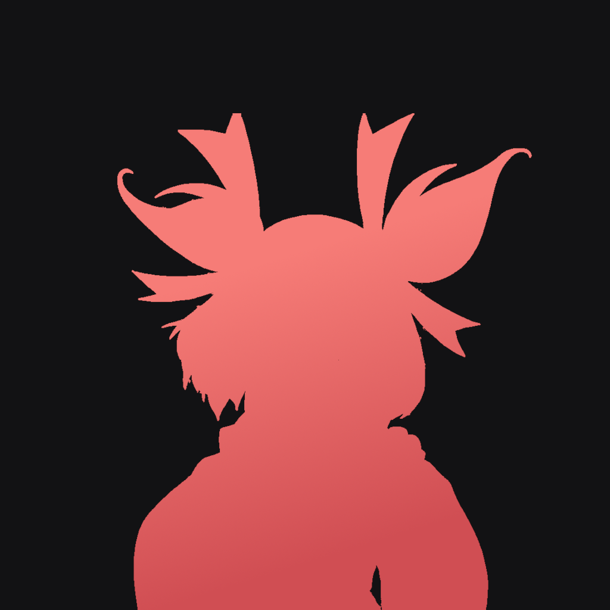

<!---
this readme sucks
--->

<!--- TITLE --->
<!-- <h1 align="left"> homura </h1> -->

# <samp>homura</samp>

<!--- SHORT DESCRIPTION --->



> A (not-so) generic music bot for Discord.

<!--- FEATURES --->

## <samp>FEATURES</samp>

- **Find it. Play it.** Search Spotify, YouTube Music, and YouTube, or drop in a track or playlist URL.
- **Own the queue.** Browse, reorder, remove, and fast-track what plays next.
- **Keep the music moving.** Pause, resume, skip, stop, and check what is playing.
- **Set the vibe.** Loop a track, loop the queue, shuffle it, or dial in the volume.
- **Built for Discord.** Crisp, interactive controls powered by [Components V2](https://docs.discord.com/developers/components/reference).

<!--- SETUP --->

## <samp>SETUP</samp>

### Prerequisites

- [mise](https://mise.jdx.dev/)
- [Bun](https://bun.sh)
- A Discord Bot Token (get one from the [Discord Developer Portal](https://discord.com/developers/applications))

### Installation

1. **Clone the repository**

   ```bash
   git clone https://github.com/janleigh/homura.git
   cd homura
   ```

2. **Install Bun with mise**

   ```bash
   mise install
   ```

3. **Install dependencies**

   ```bash
   bun install
   ```

4. **Configure environment variables**

   Create a `.env` file in the root directory:

   ```bash
   cp .env.example .env
   ```

   Edit `.env` and add your Discord bot token:

   ```env
   DISCORD_TOKEN="your-bot-token-here"
   ```

5. **Configure bot settings (optional)**

   Edit `src/config.ts` to customize:
   - `DEV_SERVER_IDS` - Server IDs where developer commands will be registered
   - `DEV_USER_IDS` - User IDs who can use developer commands
   - Bot presence and activity settings

6. **Run the bot**

   For development (with debug logging):

   ```bash
   bun dev
   ```

   For production:

   ```bash
   bun start
   ```

### Required Bot Permissions

When inviting the bot to your server, make sure it has these permissions:

- `Add Reactions` - For reacting to messages
- `Priority Speaker` - For priority voice audio
- `View Channel` - To see channels in the server
- `Send Messages` - For sending command responses
- `Manage Messages` - For managing bot messages
- `Embed Links` - For sending rich embeds
- `Attach Files` - For sending files
- `Read Message History` - For reading previous messages
- `Use External Emojis` - For using custom emojis
- `Connect` & `Speak` - For voice channel functionality
- `Move Members` - For moving members between voice channels
- `Use Voice Activity` - For voice activity detection
- `Change Nickname` - For changing the bot's nickname

Or just use the [invite link below](#links) and switch the client id to your application as it includes all necessary permissions.

<!--- LINKS --->

## <samp>LINKS</samp>

- [Invite Homura](https://discord.com/oauth2/authorize?client_id=1543828308373016636&permissions=120974656&integration_type=0&scope=applications.commands+bot)
- [Support Server](https://discord.gg/fPdqz4f8wf)

<!--- LICENSE --->

## <samp>LICENSE</samp>

This project is licensed under the [AGPL-3.0](../LICENSE.md) license.
